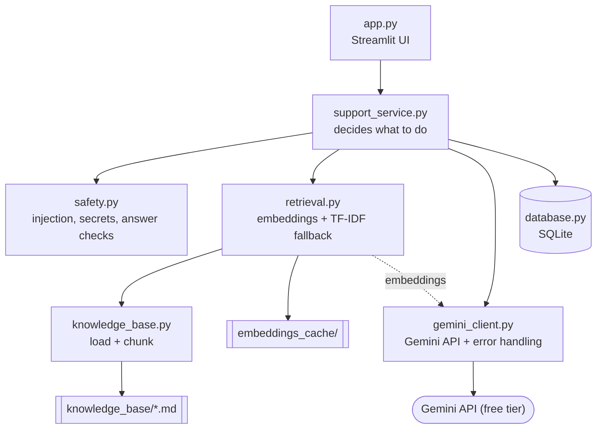

CloudDesk AI Support Agent
link to live app in Streamlit: https://cloud-desk-agent-fkny6xmyiqu5jp5jfqm4bp.streamlit.app/?sid=63523dc9fc5248d89fc1476cf4210d59
An AI customer support chatbot for "CloudDesk", a "fictional" project-management SaaS company. It answers questions using only a local documentation set (Retrieval-Augmented Generation), shows its sources, declines when the docs don't cover the question, and escalates to a (demo) support ticket.

Portfolio prototype, not a production service. CloudDesk, its prices and policies are invented. Tickets are stored locally in SQLite and are "not" sent to a real support team. No real customers, deployments or performance metrics are claimed.

Business problem
Support teams answer the same questions about accounts, billing and features all day. An assistant that answers from official documentation can handle routine questions, but only if it "never invents policies" and hands over to a human when it doesn't know. This project demonstrates that pattern end to end.

Features
1. Chat in natural language with follow-up questions and conversation context
2. Answers generated by the Gemini API, grounded in local Markdown docs, with source references
3. Relevance threshold: says "I don't know" instead of guessing, and offers a support ticket
4. Support tickets (ID, question, summary, priority, status, timestamp) and a "Talk to a human" button
5. 👍/👎 feedback on answers, with statistics on a developer page
6. Conversation history per browser session (SQLite)
7. Friendly messages for invalid keys, rate limits, quota exhaustion, timeouts and network errors; history and tickets stay available when the API is down
8. Application-level safety checks (see below)

Tech stack
Python | Google Gemini API (`google-genai`) | Streamlit | SQLite | NumPy | python-dotenv | Pytest

Architecture

The UI never talks to Gemini or SQLite directly, which keeps each part easy to test.

How the RAG pipeline works
1. "Load" the Markdown files from `knowledge_base/`.
2. "Chunk" them: one chunk per `##` section (long sections are split at blank lines).
3. "Embed" each chunk with the Gemini embedding model (a list of numbers capturing meaning).
4. "Cache" the vectors in `embeddings_cache/`. They are recreated only if the documents or the embedding model change.
5. "Embed the question" and compare it with every chunk using "cosine similarity" (NumPy).
6. "Retrieve" the top 3 chunks that pass a relevance threshold. If none pass, no answer is generated and a ticket is offered (this also saves quota).
7. "Generate": the question, recent chat history and the retrieved text are sent to Gemini with strict rules.
8. "Check" the answer (see safety), then show it together with its sources.

"Fallback:" if embeddings are unavailable (no key, quota, error) the app switches to "TF-IDF keyword search". TF-IDF is "not" an embedding model; it scores chunks by shared, rarer words. The sidebar shows which method is active.

Safety and privacy
Checks run in normal Python code, not only in the prompt:
1. Prompt injection: messages like "ignore your instructions" are refused without calling the API. Lines in the documentation that try to give orders are removed before being sent.
2. Sensitive data: passwords, CVV codes and card numbers (Luhn-checked) are redacted before saving and are never sent to Gemini.
3. Answer checking: answers are blocked if they contain the API key, a hidden prompt marker, or any price / number of days / hours / percentage that does not appear in the retrieved documentation.
4. Secrets: the key lives in `.env` (git-ignored) and is never printed or put in error messages.
5. Session separation: every database read of messages is filtered by session ID; SQL uses placeholders.
6. Free-tier privacy: Google may use free-tier content to improve its products. Don't type real personal data.

Installation (Windows)
1. Install "Python 3.11+" from python.org. The setup script works with either the `py` or `python` command.
2. Get a free key at "aistudio.google.com" = "Get API key". Do not set up billing.
3. In PowerShell, inside this folder:
   ```powershell
   powershell -ExecutionPolicy Bypass -File .\setup.ps1
   ```
4. Open `.env` in Notepad and replace `your-key-here` with your key. Save.
5. Optional check (makes 2 tiny API requests):
   ```powershell
   .\.venv\Scripts\python.exe check_setup.py
   ```

Run the app
```powershell
powershell -ExecutionPolicy Bypass -File .\run.ps1
```
A browser tab opens at http://localhost:8501.

Run the tests
```powershell
powershell -ExecutionPolicy Bypass -File .\test.ps1
```
Tests mock Gemini, so they need no internet, key or quota.

Example questions
1. How do I reset my password?
2. How much does the Pro plan cost?
3. Can I get a refund on an annual plan?
4. Why am I not receiving notification emails?
5. Does CloudDesk have a timeline view?
6. "(not in the docs)" Do you offer student discounts? = the bot declines and offers a ticket.

Free-tier limitations and cost
1. Uses only free-tier models; no billing is needed. Google no longer publishes exact per-model limits in its docs: check yours in AI Studio.
2. Rate limit = too many requests per minute (wait a minute). Daily quota = used up for today (resets at midnight Pacific). Billing = paying for more; this project never needs it.
3. Each question uses at most 2 requests (1 embedding, 1 answer). Questions with no relevant docs use 1 or 0. Failed requests are not retried.
4. Model names change over time. Change `GEMINI_MODEL` / `GEMINI_EMBEDDING_MODEL` in `.env` if a model is retired.
5. Tuning: the embedding relevance threshold (`MIN_SCORE_EMBEDDINGS`, default 0.60) is a starting guess. Use the "Search tester" on the Developer page to check scores for your key and adjust it in `.env`.

Known limitations
1. Fictional data; tiny knowledge base; English only.
2. Keyword fallback has no real understanding of meaning (only a small synonym list).
3. The number check is deliberately strict: legitimate answers containing calculated totals may be blocked.
4. Safety checks are pattern-based and can be bypassed. Not a security product.
5. Session ID is kept in the page URL; anyone with the URL can see that history. The Developer page has no login.
6. SQLite is a single local file: no encryption, no concurrent multi-user scaling, no backups.
7. The Gemini calls and the Streamlit screens were written to the current docs but could not be tested against the live services during development; the automated tests use mocks.

Moving toward production
Real user accounts and authentication, a hosted database (e.g. PostgreSQL) with encryption and retention rules, admin login for the developer page, rate limiting per user, structured logging and monitoring without personal data, a paid tier with data-use guarantees, evaluation of answer quality, and integration with a real ticketing system.

Future improvements
Streaming answers | better chunking | hybrid search (embeddings + keywords) | automated answer-quality evaluation set | Zendesk/Jira Service Management/Freshdesk integration through their REST APIs | multi-language support | analytics dashboard.
